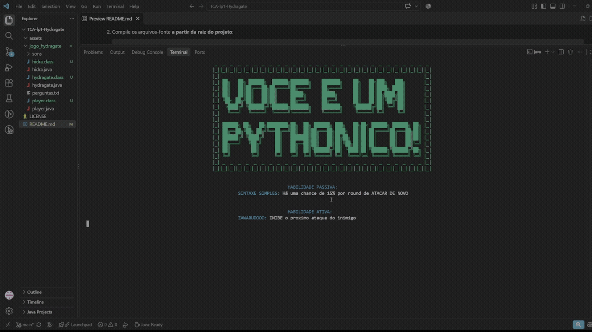

# Hydragate

Trabalho de Conclusão Anual (TCA) de Linguagem de Programação 1 — IFPR Campus Cascavel Técnico em Informática.

O jogo foi feito por Marcelo Henrique Rocha Filho & Lara Regina Bonatto, estudantes do tecnico em informática para demonstrar proeficiência em variáveis, arrays, matrizes
loops, loops aninhados e lógica de programação além de trazer algum diferencial, no caso uso básico de POO, sons e uso de outro arquivo para guardar texto

**Hydragate** é um jogo de RPG que mistura batalha por turnos com perguntas de Informática aprendidas em  Fundamentos da Informática I ministrada pelo Professor Doutor Edmar André Bellorini rodando no terminal, escrito 100% em Java (sem bibliotecas externas). Onde um malware liberado pela Hidra invadiu os arquivos da empresa e você, no papel do DEV Júnior, precisa salvá-los: escolha uma entre três classes de personagem, passe pelo *Firewall* respondendo a um quiz de conhecimentos de computação e enfrente a Hidra em uma batalha com cores, efeitos sonoros e habilidades únicas.


## Demonstração



Vídeo completo da jogabilidade no YouTube: <https://youtu.be/x-XgPuPX-8w>

## Instalação e pré-requisitos

**Pré-requisitos:**

- **JDK 8 ou superior** (o Java Development Kit já inclui o compilador `javac`; não há nenhuma dependência externa além do próprio Java).
- **VsCode** — Terminal do VsCode, PowerShell, ou qualquer outro do Linux/macOS (não usar o CMD no Windows).
- **Saída de áudio** (alto-falante/fones): opcional, mas recomendada — para tocar efeitos sonoros `.wav` durante a partida.

> De preferência use o terminal do próprio VsCode pois foi onde ocorreu os testes

**Instalação:**

1. Baixe ou clone o projeto no VsCode:

   ```bash
   git clone https://github.com/larabonatto38-dnt/TCA-lp1-Hydragate.git
   cd TCA-lp1-Hydragate
   ```

2. Compile os arquivos-fonte **a partir da raiz do projeto**:

   ```bash
   javac jogo_hydragate/*.java
   ```

> Execute sempre os comandos a partir da raiz do projeto pois o game lê as perguntas do quiz e os sons por caminhos relativos (`jogo_hydragate/perguntas.txt` e `jogo_hydragate/sons/...`); se você iniciar de outra pasta, esses arquivos não serão encontrados.

## Uso e exemplos

Na raiz do projeto, após compilar, inicie o jogo com:

```bash
java jogo_hydragate.hydragate
```

O menu inicial exibe o nome do jogo em ASCII art e aguarda uma tecla: digite **1** para começar ou **2** para sair. Em seguida, a partida segue cinco etapas:

1. **História** — a apresentação do ataque do malware e do DEV Júnior.
2. **Escolha do personagem** — digite `1`, `2` ou `3`:

   | Classe | Passiva | Habilidade ativa |
   | --- | --- | --- |
   | **Javeiro** | Compilação Rápida: +3% a 7% de dano permanente a cada 2 rodadas | Debug: super-golpe de 1,5x a 3x o seu dano |
   | **Pythonico** | Sintaxe Simples: 15% de chance por rodada de atacar de novo | Zawarudooo: inibe o próximo ataque da Hidra |
   | **Luaniano** | Pausa pro Cafezin: cura 5% a 10% da vida atual a cada 2 rodadas | Aluado: replica no inimigo o dano recebido |

3. **Firewall** — um quiz com 8 questões de conhecimentos de computação e programação (lidas de `jogo_hydragate/perguntas.txt`). Exemplo de questão: *"Qual componente é conhecido como o 'cérebro' do computador? 1- Processador (CPU); 2- Memória RAM; 3- Fonte de alimentação"*. Responda digitando o número da alternativa.
4. **Revelação da habilidade** — o jogo apresenta a passiva e a ativa da classe escolhida.
5. **Batalha contra a Hidra** — em turnos, escolha `1 - Atacar` ou `2 - Usar Habilidade Ativa` (a ativa tem *cooldown* de 3 rodadas). De tempos em tempos a Hidra solta uma baforada. As barras de vida, em cores, mostram o andamento da luta. Ao final, vitória ou derrota — com créditos.

Exemplo de resultado: se você acertar todas as 8 questões do Firewall de primeira, entra na batalha com vida e dano maiores; mas quanto mais vc errar mais a Hidra fica mais forte que você — o número de erros define os status dos dois lados.

## Estrutura do projeto

```text
TCA-lp1-Hydragate/
├── README.md              # este documento
├── LICENSE                # licença MIT do projeto
├── assets/
│   └── demo.gif           # GIF da demonstração do jogo
└── jogo_hydragate/        # código-fonte (pacote jogo_hydragate)
    ├── hydragate.java     # classe principal: menu, história, quiz, batalha, sons e telas
    ├── hidra.java         # dados do chefe (vida, dano)
    ├── player.java        # dados do jogador (vida, dano, classe escolhida)
    ├── perguntas.txt      # questões do quiz do Firewall
    └── sons/              # efeitos sonoros (.wav) usados durante o jogo
```

- **`jogo_hydragate/hydragate.java`** — ponto de entrada (`main`). Concentra toda a lógica: menu, narrativa, quiz do Firewall, sistema de batalha por turnos, reprodução de sons e telas coloridas do terminal.
- **`jogo_hydragate/hidra.java`** — classe de dados do chefe Hidra.
- **`jogo_hydragate/player.java`** — classe de dados do jogador.
- **`jogo_hydragate/perguntas.txt`** — banco de questões do quiz no formato `pergunta ; alternativa 1 ; alternativa 2 ; alternativa 3`.
- **`jogo_hydragate/sons/`** — arquivos de áudio que dão feedback às ações (ataque, dano, acerto, vitória etc.).

## Licença

Este projeto está licenciado sob a **Licença MIT** — veja o arquivo [LICENSE](LICENSE) para o texto completo.
